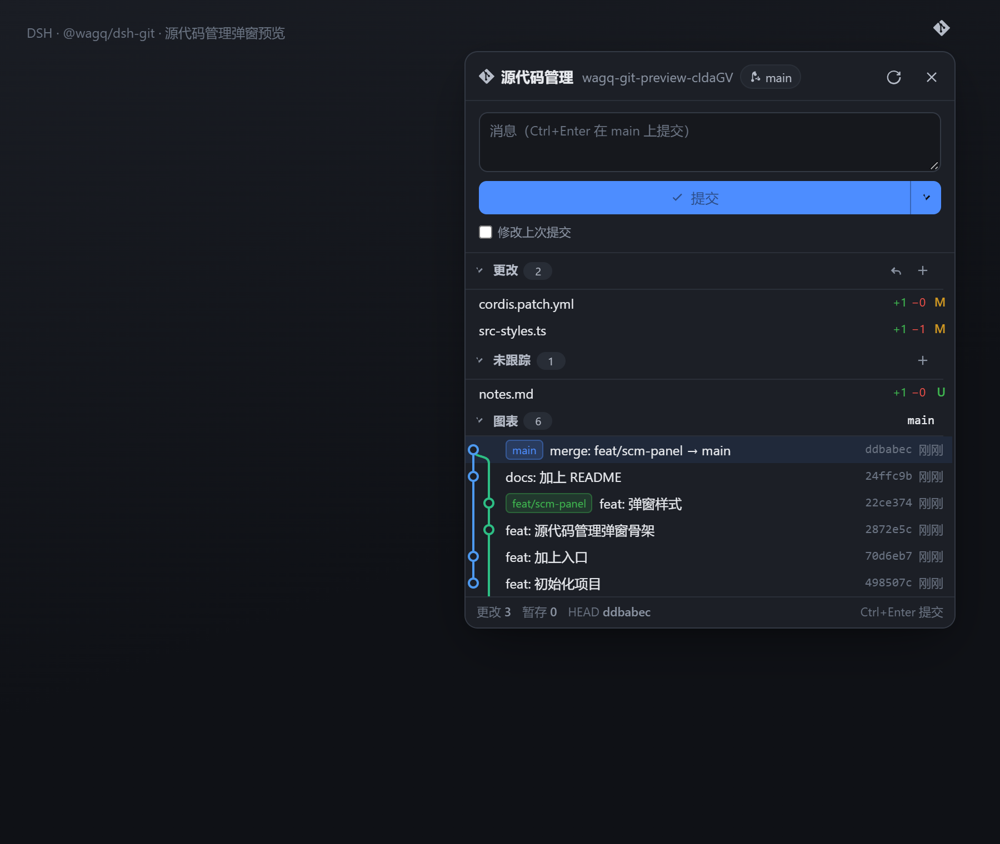

# @wagq/dsh-git

给 DeepSeek Harness 加一个 **Git 图形面板**。

装好之后，每个会话的标题栏会多一枚 Git 图标。点一下就打开一个像 VS Code「源代码管理」的弹窗：看改动、看提交图、写提交消息、处理合并冲突，都能在里面完成，不用离开当前对话。



## 它能做什么

### 查看和提交改动

- 「更改」页签列出所有改动，按 **暂存的更改 / 更改 / 未跟踪** 分组，和 VS Code 一样。
- 点任意文件，右侧显示这个文件的 diff：默认是**并排视图**（左边旧、右边新），可以切换成单栏行内视图。
- 每行右侧会显示改了多少行（`+12 −3`）和状态字母（`M` 修改、`A` 新增、`D` 删除、`U` 未跟踪）。
- 鼠标移到某一行，右侧会出现快捷按钮：暂存、取消暂存、放弃更改。
- 填好提交消息，按 `Ctrl+Enter` 或点「提交」即可提交。还可以勾选「修改上次提交」来 amend。

### 用当前会话的模型生成提交消息

提交框下面有一个 `✦ 生成提交消息` 按钮。点一下，插件会把当前的改动交给**这个会话正在使用的模型**，让它写一条提交消息，然后自动填进提交框。生成完可以直接改，再提交。

如果当前会话没选模型，就用你在设置里配的默认模型。要是模型没配密钥或被限流，按钮下面会直接告诉你原因。

### 看提交图和远程对比

- 「图表」页签是一张分泳道的提交图，和 VS Code 的 Git Graph 类似。点任意提交，右侧展开这个提交的作者、时间、改动文件和完整 diff。
- 右键提交行，可以：复制哈希、复制提交消息、撤销这个提交、重置到这个提交、rebase 到这个提交。重置和 rebase 会先弹窗确认。
- 标题栏上的分支按钮点开可以切换分支、创建新分支。
- 分支旁边的 `↑2 ↓1` 是和远程的差距，点开可以看到具体是哪些提交「领先」和「落后」，点其中一条直接跳到它的详情。

### 拉取、推送和远程管理

标题栏的 `⋯` 按钮里有：拉取（Pull）、推送（Push）、抓取（Fetch）、切换分支、暂存全部、远程管理、打开终端、刷新。菜单项上会带着实时的领先/落后数量。

「远程管理」可以添加、修改、删除远端地址。

### 合并冲突

仓库出现合并冲突时，改动列表顶部会出现一个红色的「合并冲突」分组。点冲突文件，右侧显示双方的完整内容（ours / theirs）和带冲突标记的原始文件：

- 点「采用当前分支」或「采用传入分支」即可解决整个文件的冲突（等价于编辑器里的 Accept Current / Accept Incoming）。
- 想手动挑着改，可以用终端页签自己处理。

解决后冲突会从列表里消失。

### 内嵌 Git 终端

「终端」页签是一个挂在仓库目录下的命令行，可以敲任意命令，`git` 开头的尤其方便。会显示输出、退出码和耗时。`cd` 到子目录后，下一条命令会继续在那个目录里执行。支持上下键翻历史、`Ctrl+L` 清屏，下面还有几个常用命令的快捷按钮。

## 安装

需要本机装了 `git`，并且 `git` 在 PATH 里能直接运行。

在项目目录的**父目录**执行（路径要写完整）：

```sh
dsh plugin --profile desktop add "link:D:/code/dsh plugin/dsh-wa-git"
```

然后打开或重启 DSH。标题栏出现 Git 图标就说明装好了。

> 如果你是开发者、改了插件源码，需要进插件目录跑一次 `pnpm install && pnpm run build`，再刷新页面或重启 DSH。

## 常见问题

- **看不到 Git 图标？** 确认刚才的 `dsh plugin add` 用的是 desktop profile，然后重启 DSH。
- **点开提示「没有可用的工作目录」？** 先打开一个工作区里的会话，再点图标。
- **生成提交消息报错？** 通常是当前模型没配好密钥、或者被限流了，报错信息里会写明原因。换一个已在设置里配好的模型再试。
- **冲突点「采用」没反应？** 确认这个文件确实处于冲突状态；如果已经手动改完标记，先在终端里 `git add <文件>`。

## 授权说明

这个插件在你本地运行 git 命令；「生成提交消息」会把**当前暂存区的 diff** 发给当前会话使用的模型服务。除此之外不会上传仓库里的其它内容。
